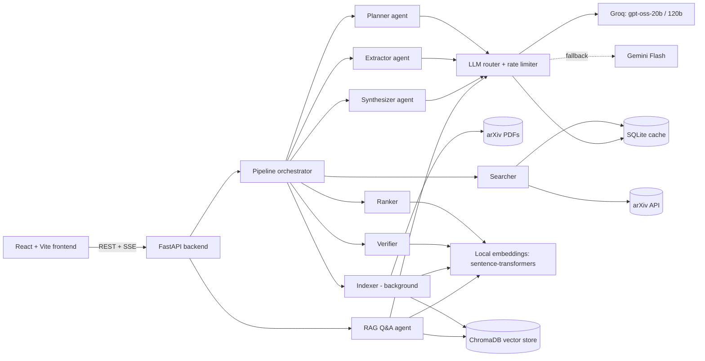

# DESIGN — LitLens

How the system is built. Requirements live in `SRS.md`, security rules in `SECURITY.md`.

---

## 1. Architecture



**Principles**
- Each agent is **one function with one job**: typed input → typed output (Pydantic). The orchestrator wires them together and emits events.
- **Cheap work runs locally** (ranking, verification, retrieval). The LLM is only used where language understanding or generation is needed.
- **Every external call goes through the cache.** Repeated runs are free and demo mode replays them offline.
- **Fail soft:** a failed stage degrades the output and adds a warning. It does not crash the job.

---

## 2. Tech Stack

| Layer | Choice | Why |
|---|---|---|
| Backend | Python 3.14, FastAPI, Uvicorn, Pydantic v2, pydantic-settings | Async, typed, auto-generated docs at `/docs` |
| Streaming | SSE via `sse-starlette` | Simpler than WebSockets for one-way progress |
| arXiv | `arxiv` Python package (`Client(delay_seconds=3, num_retries=3)`) | Handles paging, parsing and polite delays |
| HTTP | `httpx` (PDF downloads) | Timeouts, streaming, size limits |
| PDF | PyMuPDF (`pymupdf`) | Fast, accurate per-page text, wheels for Windows and macOS |
| Embeddings | `sentence-transformers`, model `all-MiniLM-L6-v2` (384-dim) | Small, fast on CPU, uses Apple Silicon GPU (MPS) automatically |
| Vector store | ChromaDB (persistent, one collection per job) | Real vector DB. Behind an interface so a NumPy fallback can replace it if install fails |
| LLM primary | Groq SDK (`groq`) | Very fast, free tier |
| LLM fallback | Google Gen AI SDK (`google-genai`) | Large context, separate quota |
| Retry | `tenacity` | Backoff on 429/5xx |
| Cache | SQLite (stdlib `sqlite3`) | Zero setup |
| Frontend | React + Vite + TypeScript, Tailwind CSS, `react-markdown` + `remark-gfm` | Fast dev, safe Markdown rendering |
| Tests | pytest, ruff | Mock LLM and network |

---

## 3. Pipeline (stage by stage)

Token figures are estimates (≈ 4 characters per token). Budgets must keep each model under **8K TPM**.

| # | Stage | Model / tool | Input → Output | Budget |
|---|---|---|---|---|
| 1 | **Planner** | `gpt-oss-20b` | topic → 2–3 search queries (JSON) | ~0.5K tokens |
| 2 | **Searcher** | arXiv API | queries → ≤ 25 unique candidates (id, title, authors, year, abstract, category, links) | 3s gap between requests |
| 3 | **Ranker** | local embeddings | topic + abstracts → cosine scores → top N (default 8) | 0 LLM tokens |
| 4 | **Extractor** | `gpt-oss-20b` | batches of ~4 papers (title + abstract) → `Extraction[]` (strict JSON schema) | ~2.5K per batch, 2 batches |
| 5 | **Synthesizer** | `gpt-oss-120b` | topic + paper list + extractions → `review_md` with `[n]` citations | ~5K |
| 6 | **Verifier** | local embeddings | review sentences + cited papers → validity, support scores, flags | 0 LLM tokens |
| 7 | **Indexer** (background) | httpx + PyMuPDF + embeddings + Chroma | PDFs → page text → chunks → vectors | 0 LLM tokens, 3s between downloads |
| — | **Q&A** (on demand) | local retrieval + `gpt-oss-120b` | question → top-4 chunks → answer with `[n, p.X]` | ~3K per question |

**Total per run ≈ 10–12K tokens**, split across two models, within NFR-2.

### 3.1 Planner
- Prompt: produce 2–3 *different* phrasings (synonyms, sub-areas, method names) suitable for arXiv search. Return JSON `{"queries": [...]}`.
- Validate. On any failure, use `[topic]`.

### 3.2 Searcher
- For each query, `arxiv.Search(query=q, max_results=10, sort_by=Relevance)`.
- De-duplicate by arXiv ID **without version suffix** (`2401.01234v2` → `2401.01234`).
- Normalise to the `Paper` model (§4). Cache by query string.

### 3.3 Ranker
- Embed the `topic` and each `title + ". " + abstract`. Normalise and take the dot product (cosine).
- Select the top N. Assign `ref` numbers 1..N in rank order.
- Optional `year_from` filter before ranking.

### 3.4 Extractor
- Use Groq **structured output** with a JSON schema for `{"extractions": Extraction[]}`. Validate with Pydantic. On failure, retry once with the validation error appended, then fall back to the other provider, then to an empty extraction with all fields `"Not reported"`.
- Paper text is wrapped in delimiters (see SECURITY.md §4):
  `<paper ref="3">TITLE: ...\nABSTRACT: ...</paper>`
- Rules in the system prompt: extract only what's stated; use `"Not reported"` when absent; keep values short (≤ 25 words); metrics exactly as written.
- For gpt-oss models, set **low reasoning effort** if the SDK/API supports it (reasoning tokens count toward TPM). Check the current Groq docs.

### 3.5 Synthesizer
- Input: topic, numbered paper list (ref, title, year) and extraction JSON. **Not** the raw abstracts, which saves tokens.
- Output: Markdown with exactly these H2 sections: `## Overview`, `## Key Themes`, `## Methods & Results Comparison`, `## Research Gaps`, `## Conclusion`.
- Rules: cite with `[n]` or `[n][m]` only, using refs in 1..N; every factual sentence must cite; never mention papers that aren't in the list; research gaps must be grounded in limitations or "Not reported" patterns; 350–600 words.

### 3.6 Verifier
1. Split `review_md` into sentences (skip headings).
2. Extract `[n]` markers with regex `\[(\d+)\]`. Any ref outside 1..N → remove from text and record in `invalid_refs`.
3. For each cited sentence and cited paper: support = max cosine(sentence, abstract), cosine(sentence, extraction summary). If support < `SUPPORT_THRESHOLD` (default **0.35**, tune using the eval set) → add to `weak_claims`.
4. `citation_validity` = valid markers / total markers (after removal, the shown text is 100% valid; report the pre-removal figure in stats for honesty).
5. `uncited_sentences` = factual sentences with no marker (outside the Overview's first sentence). Report the count.

### 3.7 Indexer and Q&A
- Download `https://arxiv.org/pdf/{arxiv_id}` (URL built from a validated ID only). Timeout 30s, max size 25 MB, check `%PDF` magic bytes.
- PyMuPDF: text per page. Chunker: ~500 tokens (~2,000 characters) with 100-token overlap, so top-4 chunks stay ≈ 2K input tokens. Never split mid-word. Keep `{ref, arxiv_id, page}` metadata.
- Embed the chunks and store them in Chroma collection `job_{job_id}`.
- Q&A: embed the question, take the top 4 chunks (optionally max 2 per paper for diversity), then prompt: answer only from the chunks, cite `[n, p.X]`, and if the answer isn't present say "The selected papers don't cover this."

### 3.8 Orchestrator and Jobs
- `POST /api/reviews` creates a `Job` (UUID4), stores it in an in-memory registry and starts the pipeline as an `asyncio` task.
- Each stage emits events into the job's `asyncio.Queue`. The SSE endpoint drains the queue and replays past events to late subscribers (keep an event history list per job).
- Results are saved to `data/reviews/{job_id}.json` so they survive restarts. The registry reloads lazily.
- Blocking work (embeddings, PyMuPDF, arxiv client) runs in `asyncio.to_thread`.
- Only one pipeline runs at a time, through a global semaphore. This protects the quota and the demo laptop.

---

## 4. Data Contracts (shared with the frontend)

These schemas are the contract. On Day 1, `frontend/src/mocks/review.json` and `frontend/src/mocks/events.json` must be generated to match them exactly. The frontend builds against the mocks until the live API is ready.

### 4.1 Request / Job
```jsonc
// POST /api/reviews
{ "topic": "crop disease detection using deep learning", "max_papers": 8, "year_from": null }
// → 202
{ "job_id": "9f1c...", "status": "queued" }
```

### 4.2 SSE Event (`GET /api/reviews/{id}/events`, `event: stage`)
```jsonc
{
  "job_id": "9f1c...",
  "stage": "planning|searching|ranking|extracting|synthesizing|verifying|indexing|done|error",
  "status": "started|progress|completed|failed|skipped",
  "message": "Extracting 5/8 papers",
  "progress": { "current": 5, "total": 8 },      // optional
  "elapsed_ms": 18234,
  "tokens": { "openai/gpt-oss-20b": 3120 },       // optional, cumulative for the stage
  "provider": "groq|gemini|cache"                 // optional
}
```
The stream ends with `stage: "done"` (or `"error"`). Indexing continues after `done` and emits its own events, with `qa_ready` turning true when finished. The frontend should keep the stream open until `indexing` completes, or poll `GET /api/reviews/{id}`.

### 4.3 Review Result (`GET /api/reviews/{id}`)
```jsonc
{
  "job_id": "9f1c...",
  "status": "running|done|error",
  "topic": "crop disease detection using deep learning",
  "created_at": "2026-11-21T10:00:00Z",
  "queries": ["crop disease detection deep learning", "plant leaf disease CNN", "..."],
  "papers": [{
    "ref": 1,
    "arxiv_id": "2401.01234",
    "title": "…",
    "authors": ["A. Author", "B. Author"],
    "year": 2024,
    "published": "2024-01-03",
    "primary_category": "cs.CV",
    "abstract": "…",
    "url_abs": "https://arxiv.org/abs/2401.01234",
    "url_pdf": "https://arxiv.org/pdf/2401.01234",
    "relevance": 0.78,
    "fulltext_status": "pending|indexed|abstract_only|failed"
  }],
  "extractions": [{
    "ref": 1,
    "problem": "…",
    "method": "…",
    "datasets": ["PlantVillage"],
    "metrics": [{ "name": "Accuracy", "value": "97.2%" }],
    "key_result": "…",
    "limitations": "Not reported"
  }],
  "review_md": "## Overview\nMost recent work uses CNNs … [1][3]. …",
  "verification": {
    "citation_validity": 1.0,
    "invalid_refs": [],
    "weak_claims": [{ "sentence": "…", "ref": 4, "score": 0.29 }],
    "uncited_sentences": 1
  },
  "stats": {
    "total_ms": 52340,
    "stage_ms": { "planning": 900, "searching": 9800, "ranking": 1200, "extracting": 14000, "synthesizing": 21000, "verifying": 600 },
    "tokens": { "openai/gpt-oss-20b": 5400, "openai/gpt-oss-120b": 4800 },
    "providers_used": ["groq"],
    "papers_considered": 23,
    "papers_selected": 8
  },
  "warnings": [],
  "qa_ready": false
}
```

### 4.4 Q&A
```jsonc
// POST /api/reviews/{id}/ask
{ "question": "Which papers test on real field images?" }
// → 200
{
  "answer_md": "Only [4, p.6] evaluates on field photos, reporting 81% accuracy …",
  "sources": [{ "ref": 4, "arxiv_id": "…", "page": 6, "snippet": "…", "score": 0.71 }]
}
// → 409 if qa_ready is false
```

### 4.5 Errors
`{ "error": { "code": "VALIDATION_ERROR|NOT_FOUND|NOT_READY|RATE_LIMITED|UPSTREAM_ERROR|INTERNAL", "message": "human-readable" } }`. Never include stack traces or keys.


### 4.6 Misc endpoints
```jsonc
// GET /api/health
{ "status": "ok", "version": "0.1.0", "env": "dev|prod", "demo_mode": false,
  "providers": { "groq": true, "gemini": false } }   // gemini = key AND GEMINI_MODEL set
// GET /api/demo-topics
{ "topics": ["crop disease detection using deep learning", "..."] }
```

**Contract sources:** `backend/app/models/schemas.py` ↔ `frontend/src/api/types.ts` ↔ `frontend/src/mocks/*.json`. The backend test `tests/test_mocks_match_schemas.py` fails if a mock drifts from the Pydantic models.

---

## 5. LLM Layer

```
llm/
  base.py        # LLMProvider protocol: complete(messages, model, json_schema=None, max_tokens) -> LLMResult(text, tokens_in, tokens_out, provider, model)
  groq_provider.py
  gemini_provider.py
  ratelimit.py   # per-model token bucket (TPM) + request bucket (RPM)
  router.py      # choose provider/model per task, retries, fallback, caching
  prompts/       # one .md or .py per agent; versioned (PROMPT_VERSION in cache key)
```

**Task → model mapping (configurable in `.env`)**
| Task | Primary | Fallback |
|---|---|---|
| plan, extract | `GROQ_FAST_MODEL=openai/gpt-oss-20b` | `GEMINI_MODEL` |
| synthesize, answer | `GROQ_SMART_MODEL=openai/gpt-oss-120b` | `GEMINI_MODEL` |

`GEMINI_MODEL` has no hard-coded default: the developer sets the current Flash model ID from Google AI Studio. If `GEMINI_API_KEY` is missing, fallback is disabled and the router logs a warning at startup.

**Rate limiter:** before each call, estimate tokens (`len(prompt_chars)/4 + max_tokens`) and `await bucket.acquire(model, est)`. Limits come from `.env` (`GROQ_TPM=8000`, `GROQ_RPM=30`). Leave a 10% safety margin. After the call, reconcile with actual usage from the response.

**Retry/fallback:** on 429, read `retry-after` and wait if it's ≤ 10s, otherwise switch to the fallback immediately. On 5xx or timeout, retry once, then fall back. Emit `provider` in the stage events so the UI shows "switched to Gemini".

**Cache key:** `sha256(provider|model|prompt_version|messages_json|schema_json)`. Cache hits report `provider: "cache"` and 0 tokens.

---

## 6. Frontend Design

### 6.1 Screens
1. **Home:** app title and one-line pitch ("A cited literature review from live arXiv papers in about a minute"), a large topic input, a paper-count selector (4–12), a **Generate review** button, and demo topic chips below.
2. **Run view:** a vertical **agent timeline** with one row per stage: icon, name, status (spinner/✓/⚠/✗), message, duration, tokens, and a provider badge. Paper titles appear live as the searcher and ranker finish.
3. **Results:** stats bar on top, then tabs:
   - **Review:** rendered Markdown. `[n]` becomes a chip (popover with title, authors, year, arXiv link). Weak claims get a dotted underline and ⚠ tooltip.
   - **Comparison:** sortable table: Ref · Title · Method · Dataset(s) · Key Result · Limitations. "Not reported" shown greyed.
   - **Papers:** cards with relevance bar, collapsible abstract, arXiv links and full-text status badge.
   - **Ask:** chat panel, disabled with an "Indexing full text… 5/8" note until `qa_ready`. Answers show source snippets.
   - **Export:** buttons for Markdown, BibTeX and Print.

### 6.2 Components
`TopicForm`, `DemoTopicChips`, `AgentTimeline`, `StatsBar`, `ReviewView`, `CitationChip`, `ComparisonTable`, `PaperCard`, `AskPanel`, `ExportMenu`, `ErrorBanner`.

### 6.3 Data Layer
- `src/api/client.ts`: typed fetch wrappers. `src/api/types.ts` mirrors §4 exactly.
- `src/api/sse.ts`: `EventSource` wrapper with reconnect.
- `VITE_USE_MOCKS=true` → the client returns fixtures and replays `events.json` with timers.
- The Vite dev server proxies `/api` → `http://127.0.0.1:8000`, so there are no CORS problems in development.

### 6.4 Visual Style
Clean, academic, dark-first: neutral slate background, one accent colour, serif headings (e.g. "Source Serif") and sans-serif body text. Generous spacing. Timeline rows animate in. No stock images.

---

## 7. Caching, Demo Mode and Pre-warm
- `data/cache.sqlite` tables: `http_cache(key, value, created_at)`, `llm_cache(key, value, tokens_in, tokens_out, created_at)`.
- `scripts/prewarm.py "topic 1" "topic 2" ...` runs the full pipeline including indexing and saves the results.
- `DEMO_MODE=true`:
  - `/api/demo-topics` lists pre-warmed topics.
  - `POST /api/reviews` with a cached topic replays the stored event history with the original relative timings (capped at 1.5s per event, so the replay takes about 15–25s and still looks live).
  - Uncached topics return a friendly error: "Offline demo mode: choose a demo topic."
  - No outbound network calls are made at all.

---

## 8. Repository Layout
```
ManthanKriti/                  # repo root
├─ CLAUDE.md  SRS.md  DESIGN.md  SECURITY.md  README.md
├─ .env.example  .gitignore
├─ backend/
│  ├─ requirements.txt  pyproject.toml (ruff/pytest config)
│  ├─ app/
│  │  ├─ main.py               # FastAPI app, CORS, routers, startup checks
│  │  ├─ config.py             # pydantic-settings Settings
│  │  ├─ api/                  # routes_reviews.py, routes_misc.py
│  │  ├─ models/schemas.py     # all Pydantic models (§4)
│  │  ├─ agents/               # planner, searcher, ranker, extractor, synthesizer, verifier, qa
│  │  ├─ pipeline/             # orchestrator.py, jobs.py, events.py
│  │  ├─ llm/                  # §5
│  │  ├─ retrieval/            # embeddings.py, chunker.py, vectorstore.py, pdf.py
│  │  └─ services/             # arxiv_client.py, cache.py, export.py (md, bibtex)
│  ├─ scripts/prewarm.py
│  └─ tests/
├─ frontend/                   # Vite React TS app
│  └─ src/{api,components,mocks,pages,styles}
├─ eval/                       # topics.yaml, run_eval.py, results.md, results.csv
└─ data/                       # gitignored: cache.sqlite, chroma/, pdfs/, reviews/
```

---

## 9. Error Handling Matrix

| Failure | Behaviour |
|---|---|
| Planner LLM fails | Use the raw topic as the query; warning |
| arXiv down or timeout | Retry ×3 (built into the client). Then error, or replay the cache in demo mode |
| < 4 candidates found | Continue with what was found; warning "few papers found, try a broader topic" |
| Extraction JSON invalid | Retry once with the error → fallback provider → "Not reported" placeholders |
| Synthesizer fails on both providers | Return papers, extractions and table without the review; status `done` with a warning |
| 429 rate limit | Wait if retry-after ≤ 10s, otherwise fall back to Gemini; timeline shows the switch |
| PDF download/parse fails | Index the abstract only; mark `abstract_only` |
| Chroma import fails | Use the NumPy in-memory vector store (same interface); log once |
| Client disconnects from SSE | Job continues; history replays on reconnect |

---

## 10. Testing and Evaluation
- **Unit tests (pytest, no network):** chunker boundaries, citation regex and invalid-ref removal, support scoring with stub embeddings, rate-limiter timing, schema validation and retry path, BibTeX formatting, arXiv ID validation, cache key stability.
- **Integration test:** full pipeline with a fake LLM provider and recorded arXiv fixtures.
- **Smoke script:** `scripts/smoke.py` runs one real topic end to end and prints stage timings (manual, uses quota).
- **Eval:** `eval/run_eval.py` per SRS FR-60–62. It uses the cache, so re-runs are free. Tune `SUPPORT_THRESHOLD` with the eval results.
